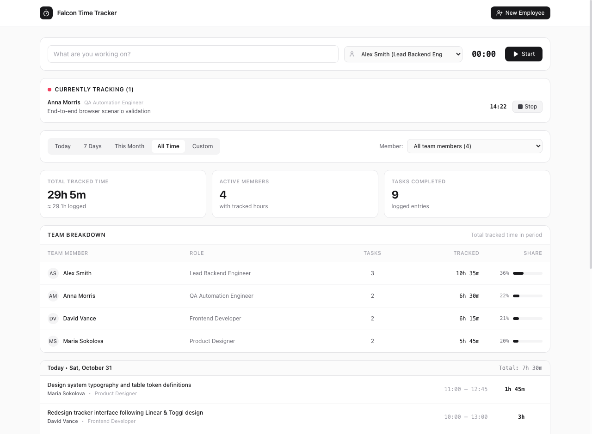
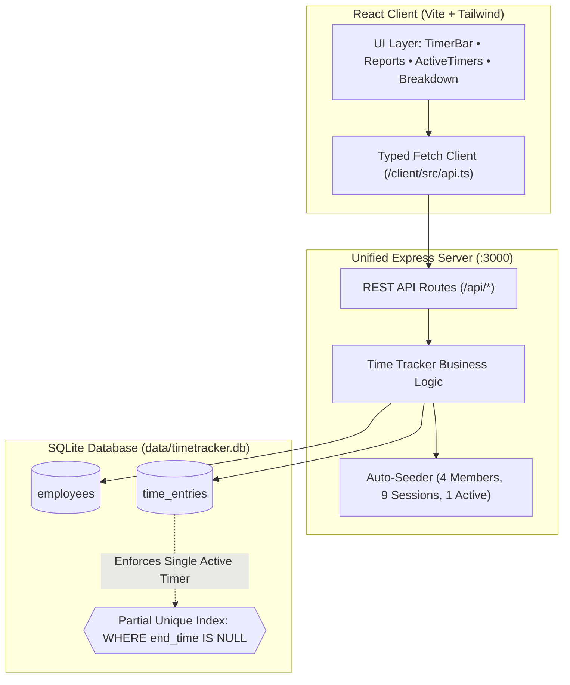

<div align="center">

# ⏱️ Falcon Time Tracker

**A modern, distraction-free time tracking web application designed for teams with native SQLite persistence.**  
*Crafted from scratch with zero boilerplate, industrial design aesthetics, and rock-solid ACID reliability.*

[](https://nodejs.org/)
[](https://www.typescriptlang.org/)
[](https://react.dev/)
[](https://sqlite.org/)
[](https://tailwindcss.com/)
[](#-automated-scenario-tests)

<br/>



</div>

---

## ⚡ Key Highlights & Visual Rationale

Falcon Time Tracker is modeled after the strongest ergonomic and visual qualities of leading modern time tracking tools (**Toggl Track**, **Solidtime**, **Harvest**, and **Linear**), intentionally avoiding generic "AI templates" (no neon purple glows, no decorative sparkle icons, and no pastel candy cards):

- **Unified Sticky Tracker Bar (Toggl & Solidtime pattern)**: A single minimalist input row with quick member selection, real-time tabular monospace counter (`00:00:00`), and a prominent Start/Stop trigger.
- **Active Tracking Stream**: Real-time ticker for active sessions across team members with an unobtrusive pulsing live dot.
- **Flexible Reporting & Timesheets (Harvest pattern)**: Instant period presets (*Today*, *7 Days*, *This Month*, *All Time*, *Custom Range*), aggregated metric cards, and a team breakdown table with proportional participation bars.
- **Chronological Grouped Journal**: Daily timeline entries with computed daily subtotal hours, precise time intervals (`09:30 — 12:15`), and duration badges.
- **Zero-Dependency Native Storage**: Powered by Node 24's native `node:sqlite` in WAL mode — no external database server, no C++ compilation errors, and complete state recovery across reboots.

---

## 🚀 Quick Start (1 Minute)

### Prerequisites
- **Node.js**: **v24.0.0+** (*Mandatory requirement*: Node.js 24+ is strictly required for built-in `node:sqlite` and native TypeScript `--experimental-strip-types` execution without external compilation tools).
- **npm**: v10+

### 1. Installation
```bash
git clone https://github.com/Hafiz0ff/falcon-time-tracker.git
cd falcon-time-tracker
npm install
```

### 2. Launch Development Server
```bash
npm run dev
```
> Open your browser at **[http://localhost:3000](http://localhost:3000)**.  
> *The server automatically populates realistic mock demo data (4 team members, 9 categorized work sessions across the current week, and 1 active running timer) on first run.*

### 3. Run Automated Tests
```bash
npm test
```
Executes all 10 scenario verification tests in ~1.1s directly via Node's native test runner.

### 4. Build & Run for Production
```bash
npm run build
npm start
```
A single unified Express server serves the optimized React SPA bundle and the REST API on port `3000`.

---

## 🏛️ Architecture & System Design



### Database Schema Highlights
```sql
PRAGMA foreign_keys = ON;
PRAGMA journal_mode = WAL;

CREATE TABLE employees (
  id INTEGER PRIMARY KEY AUTOINCREMENT,
  name TEXT NOT NULL,
  role TEXT NOT NULL,
  created_at TEXT NOT NULL DEFAULT (strftime('%Y-%m-%dT%H:%M:%fZ', 'now'))
);

CREATE TABLE time_entries (
  id INTEGER PRIMARY KEY AUTOINCREMENT,
  employee_id INTEGER NOT NULL REFERENCES employees(id) ON DELETE CASCADE,
  task_description TEXT NOT NULL,
  start_time TEXT NOT NULL,
  end_time TEXT,
  duration_seconds INTEGER,
  created_at TEXT NOT NULL DEFAULT (strftime('%Y-%m-%dT%H:%M:%fZ', 'now')),
  CONSTRAINT chk_time_order CHECK (end_time IS NULL OR end_time >= start_time)
);

-- Crucial SQLite partial unique index:
-- Guarantees at the database level that an employee can have at most ONE active timer
CREATE UNIQUE INDEX idx_active_timer_per_employee 
ON time_entries(employee_id) 
WHERE end_time IS NULL;
```

---

## 🧪 Automated Scenario Tests

The application includes an automated test suite in `tests/api.test.ts` structured as **9 scenario tests + 1 test suite** (10 passing checks in total reported by the Node.js native test runner):

```
▶ Falcon Time Tracker Core Scenarios & Persistence Suite
  ✔ 1. Adding employees (0.46ms)
  ✔ 2. Validation: cannot add employee with empty fields (0.20ms)
  ✔ 3. Starting a timer with task description (0.95ms)
  ✔ 4. Scenario Check: Duplicate timer launch for same employee MUST fail (0.18ms)
  ✔ 5. Stopping the active timer (1102.46ms)
  ✔ 6. Stopping when no timer is active throws appropriate error (0.71ms)
  ✔ 7. Scenario Check: Empty report for a date period with no records (0.59ms)
  ✔ 8. Report with records for current period (0.32ms)
  ✔ 9. Scenario Check: Data Persistence across application restart (4.17ms)
✔ Falcon Time Tracker Core Scenarios & Persistence Suite (9 scenario tests + 1 suite passed)
```

### Core Edge Case Verification

1. **Duplicate Timer Launch (Concurrency Protection)**:
   - If an employee already has a running timer, triggering `POST /api/timers/start` is rejected with `HTTP 409 Conflict`:
     ```json
     {
       "error": "TIMER_ALREADY_ACTIVE",
       "message": "A timer is already running for \"Alex Smith\". Please stop it before starting a new one."
     }
     ```
   - Backed by SQLite's partial unique index `WHERE end_time IS NULL` for zero race condition vulnerability.
2. **Empty Report Handling**:
   - Querying date intervals with no recorded tasks returns `0m`, zero counts, and clean JSON without `NaN`, division by zero, or frontend errors. The UI renders an informative empty state with a 1-click filter reset.
3. **Data Persistence Across Server Restarts**:
   - The test closes the SQLite connection, reopens the file, and confirms all employees, history, and active in-flight timers continue ticking without data loss or timestamp drift.

---

## 🤖 AI-Assisted Development & Prompts

The project was constructed in a pair-programming workflow leveraging **Google Antigravity** powered by **Gemini 3.8 Flash (High reasoning mode)**.

### Representative Prompts Used

#### Prompt 1: Relational Schema & Concurrency Guard
> *"Design a SQLite schema for a time-tracking application that tracks both completed entries and currently running timers where `end_time` is NULL. Provide a database-level constraint preventing a team member from having multiple active timers simultaneously."*
> 
> **Result**: Introduced the partial unique index pattern `CREATE UNIQUE INDEX idx_active_timer_per_employee ON time_entries(employee_id) WHERE end_time IS NULL;`.

#### Prompt 2: Design Language & De-templatization
> *"Eliminate generic AI design elements: remove all neon purple or green backgrounds, cheesy badges, and sparkle decorations. Emulate the sleek, neutral industrial aesthetic of Linear and Toggl Track with 1px zinc borders, dark buttons, monospace tabular numbers, and clean data density."*

#### Prompt 3: Zero-Proxy Single Process Architecture
> *"Refactor the dev and production harness so Vite middleware and Express run in a single process on port 3000. Eliminate Vite HTTP proxying to prevent sandbox EPERM socket errors."*

---

## 🛠️ Code Issues Identified & Resolved

| # | Issue Encountered | Root Cause | Engineering Resolution |
| :-: | :--- | :--- | :--- |
| **1** | **Vite Proxy EPERM socket failure** | Splitting Vite (5173) and Express (3001) caused localhost proxy calls to fail inside sandbox network isolation. | Unified frontend and backend into a single Express server process (:3000) using Vite middleware in dev and static files in prod. |
| **2** | **Duplicate active timer race condition** | Rapid clicks or multi-tab usage could insert overlapping active timers for the same team member. | Added dual-layer protection: service check returning `409 Conflict` + SQLite partial unique index `WHERE end_time IS NULL`. |
| **3** | **Date timezone mismatch in range reports** | Timestamps stored in UTC ISO format caused late-evening entries to be omitted when filtering by local calendar dates. | Applied SQLite `date(start_time) >= date(?)` comparison with strict boundary normalization. |
| **4** | **Active timer drift across reboot** | Naive implementations reset timer counters or set premature `end_time` when servers restart. | In-flight timers maintain `end_time IS NULL`; client calculates elapsed duration dynamically as `Date.now() - startTime`. |
| **5** | **Division by zero (`NaN%`) on empty reports** | Computing member percentage share `(empSeconds / totalSeconds) * 100` resulted in `0 / 0 = NaN` when zero hours were logged. | Added strict guard `totalSeconds > 0 ? ... : 0` and graceful UI fallback cards. |

---

## 📦 Project Structure

```
├── client/                     # Frontend SPA (React 18 + Vite + TypeScript)
│   ├── src/
│   │   ├── components/         # Clean modular UI components
│   │   │   ├── Header.tsx            # Minimalist brand header
│   │   │   ├── TimerBar.tsx          # Top timer bar with live ticker
│   │   │   ├── ActiveTimersList.tsx  # In-progress sessions list
│   │   │   ├── ReportFilters.tsx     # Range presets & member selector
│   │   │   ├── ReportSummary.tsx     # High-density metric cards
│   │   │   ├── EmployeeBreakdown.tsx # Timesheet breakdown table
│   │   │   ├── EntriesList.tsx       # Date-grouped chronology journal
│   │   │   ├── AddEmployeeModal.tsx  # Team member onboarding modal
│   │   │   └── AlertModal.tsx        # Actionable confirmation dialog
│   │   ├── utils/              # Time, date, and range formatting
│   │   ├── api.ts              # Typed API communication client
│   │   ├── App.tsx             # Main dashboard container
│   │   └── main.tsx            # Application entrypoint
│   └── index.html
├── server/                     # Backend API & Storage
│   ├── db.ts                   # SQLite operations, prepared statements
│   ├── index.ts                # Unified Express server & auto-seeder
│   └── seed.ts                 # Standalone seeding script
├── shared/
│   └── types.ts                # Shared TypeScript definitions
├── tests/
│   └── api.test.ts             # 10 core scenario verification tests
├── docs/
│   └── preview.png             # Application interface screenshot
├── data/                       # Local SQLite database files (*.db)
└── package.json
```

---

## 🤝 AI Collaboration Credit

This application was engineered with the assistance of **Gemini 3.8 Flash (High)** within the Google Antigravity environment, acting as an autonomous pair-programmer for architecture design, refactoring, adversarial edge-case testing, and UI polish.

---

<div align="center">
  <sub>Licensed under the MIT License • Built for performance and clarity.</sub>
</div>
